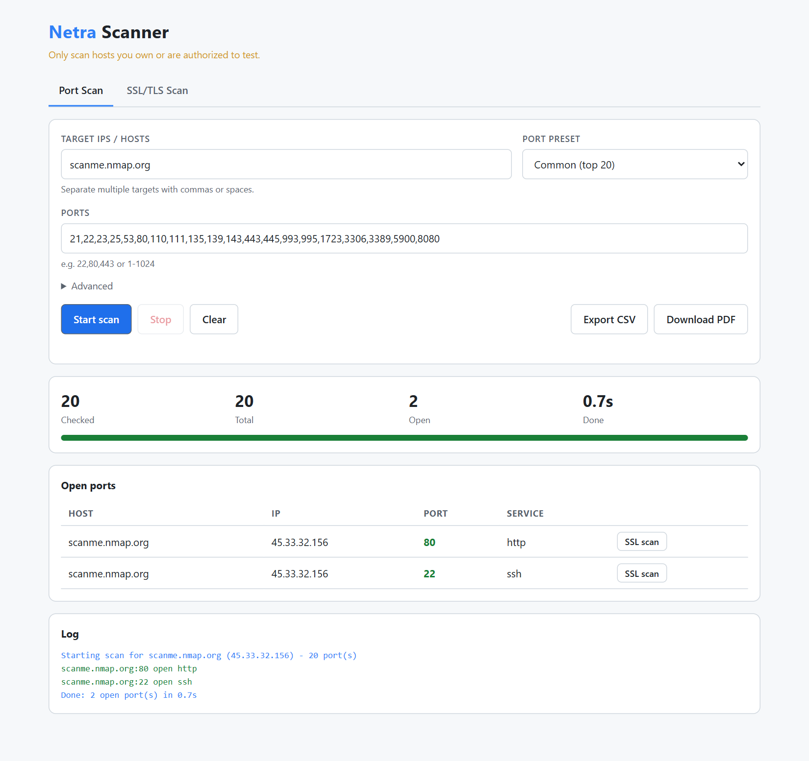
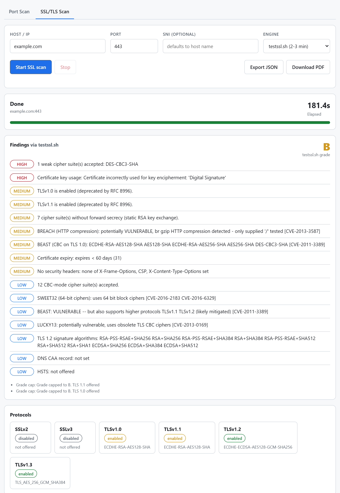
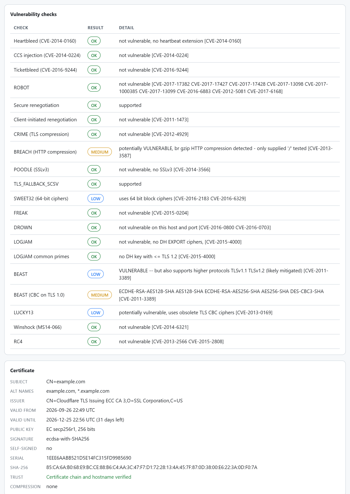

# Netra

Netra is a local network scanner with a web UI. It does two jobs:

- **Port scanning** – fast, multi-threaded TCP connect scans of one or more hosts.
- **SSL/TLS scanning** – protocol, cipher, certificate and vulnerability checks, using
  [sslscan](https://github.com/rbsec/sslscan), [testssl.sh](https://github.com/testssl/testssl.sh)
  or a built-in Python scanner.

Results can be exported as CSV, JSON or a PDF report.

> **Only scan hosts you own or are explicitly authorized to test.**

## Screenshots

**Port scan** – open ports appear live; each row has a one-click SSL scan.



**SSL/TLS scan** (testssl.sh engine) – grade, findings by severity and protocol support.



**Vulnerability checks and certificate details**



*Screenshots use [scanme.nmap.org](http://scanme.nmap.org/), which Nmap provides for scan testing, and example.com.*

## Quick start

```bash
pip install -r requirements.txt
python setup_tools.py          # downloads sslscan + testssl.sh into ./tools (optional)
python netra_web.py            # opens http://127.0.0.1:8765 in your browser
```

If port 8765 is unavailable (Windows sometimes reserves it), the server tries the next ports
and prints the address it is using. Pick a port yourself with `--port 9000`.

The web server binds to `127.0.0.1` only, so the scanner is not reachable from other machines.

## Using the web UI

### Port Scan tab

1. Enter one or more targets (IPs or hostnames, separated by commas or spaces).
2. Pick a port preset or type ports, e.g. `22,80,443` or `1-1024`.
3. Click **Start scan**. Open ports appear as they are found.

Each open port has an **SSL scan** button that switches to the SSL/TLS tab and scans it.
*Advanced* holds the per-port wait (default 0.5 s) and thread count (default 200).

### SSL/TLS Scan tab

Enter a host and port (default 443), choose an engine, and click **Start SSL scan**.
SNI is optional – use it when the server hosts several sites on one IP.

| Engine | Typical time | What it adds |
|---|---|---|
| **sslscan** (default) | ~20 s | Every accepted cipher incl. all TLS 1.3 suites, Heartbleed, renegotiation, TLS_FALLBACK_SCSV, compression |
| **testssl.sh** | 2–3 min (WSL / Linux) | A–F grade, 20 vulnerability checks with CVEs (Heartbleed, ROBOT, BREACH, POODLE, SWEET32, BEAST, LUCKY13, DROWN, LOGJAM, …), HSTS, security headers, certificate problems |
| **Netra built-in** | a few seconds | No external tools; limited by Python's OpenSSL (TLS 1.3 shows only the negotiated suite, SSLv3 and 3DES cannot be tested) |

All engines produce the same report: findings by severity, protocols, accepted cipher suites,
vulnerability checks, certificate details and chain/hostname trust. Download it with
**Export JSON** or **Download PDF**.

If the target can't be reached, Netra explains why (port closed or firewalled, connection
refused, not a TLS port, unknown host) and offers a one-click port scan of the host.

Connections use a fixed 10-second timeout.

## External tools

`python setup_tools.py` downloads pinned versions into `./tools` (ignored by git):

- **sslscan 2.2.4** – Windows build from the official releases. On Linux/macOS install it with your
  package manager (`apt install sslscan`, `brew install sslscan`); Netra finds it on `PATH`.
- **testssl.sh v3.2.5** – cloned from GitHub. It needs bash:
  - **Windows + WSL (recommended):** if any WSL distro is installed, Netra runs testssl.sh inside it
    automatically (2–3 minutes per scan). Install one with `wsl --install -d Ubuntu`.
  - **Windows + Git Bash only:** works, but a full scan takes 30–60 minutes because Git Bash
    starts processes slowly. The UI warns about this.
  - **Linux/macOS:** runs directly.

Minimal environments (Git Bash, some WSL images) lack `hexdump`, which testssl.sh requires.
Netra puts a small compatible replacement (`tools_shims/hexdump`, needs only `od` and `awk`)
on testssl.sh's `PATH`. Set `NETRA_BASH` to force a specific `bash` executable.

## Command-line tools

```bash
# Port scan
python portscanner.py 192.168.1.10,example.com -p 22,80,443 -t 1 -w 300
python portscanner.py                      # interactive prompts

# SSL/TLS scan (built-in engine)
python netra_ssl.py example.com
python netra_ssl.py 10.0.0.5:8443 --sni intranet.local
python netra_ssl.py example.com --json

# Desktop GUI (Tkinter) for port scanning
python netra_gui.py
```

## Project layout

| File | Purpose |
|---|---|
| `netra_web.py` | Local web server and the single-page UI |
| `netra_core.py` | Port-scan primitives shared by CLI, GUI and web |
| `netra_ssl.py` | Built-in SSL/TLS scanner, certificate parsing, findings, friendly connection errors |
| `netra_tools.py` | Runs sslscan / testssl.sh and normalises their output to Netra's result format |
| `netra_report.py` | PDF reports (fpdf2) |
| `portscanner.py` | Port-scan CLI |
| `netra_gui.py` | Tkinter desktop GUI |
| `setup_tools.py` | Downloads the external scanners |
| `tools_shims/hexdump` | `hexdump` replacement for testssl.sh |

## Requirements

- Python 3.9+
- `fpdf2` (PDF export), `cryptography` (detailed certificate info), `termcolor` (coloured CLI
  output) – all optional; the rest of Netra works without them.
- For testssl.sh: bash via WSL, Linux, macOS or Git Bash.
